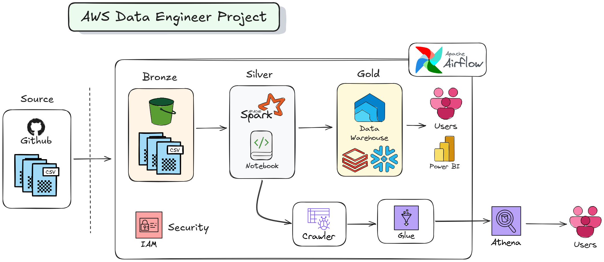
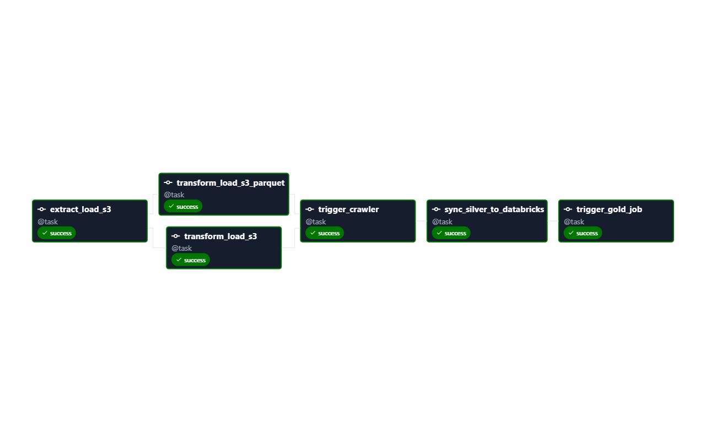

<div align="center">

# ☁️ Enterprise End-to-End Data Pipeline with Apache Airflow, AWS & Databricks
### *Orchestrating Medallion Architecture across AWS S3, AWS Glue, Athena & Databricks Lakehouse*

<p align="center">
  
  
  
  
  
  
  
  
  
</p>

<p align="center">
  <a href="#-project-architecture">Architecture</a> •
  <a href="#-tech-stack">Tech Stack</a> •
  <a href="#-medallion-pipeline-flow">Medallion Flow</a> •
  <a href="#-airflow-dag-graph">Airflow DAG</a> •
  <a href="#-project-structure">Project Structure</a> •
  <a href="#-environment-variables">Configuration</a> •
  <a href="#-quick-start--local-development">Getting Started</a> •
  <a href="#-author">Author</a>
</p>

---

</div>

## 📌 Executive Summary

This repository contains a **production-grade Data Engineering pipeline** orchestrating an end-to-end **Medallion Architecture (Bronze ➔ Silver ➔ Gold)**. 

Using **Apache Airflow 3.x** deployed via containerized Docker services, the DAG orchestrates API data ingestion, data lake partitioning on **Amazon S3**, scalable **Apache Spark ETL** transformations on **AWS Glue**, automated schema cataloging via **AWS Glue Crawlers**, and business-layer lakehouse aggregations on **Databricks** using the official **Databricks SDK**.

```
   [ REST API / Source ]
             │
             ▼
    ┌─────────────────┐
    │  BRONZE LAYER   │ ➔ Raw CSV Ingestion into Amazon S3 (Date-Partitioned)
    └────────┬────────┘
             ▼
    ┌─────────────────┐
    │  SILVER LAYER   │ ➔ AWS Glue Spark Jobs (Cleaning, Deduplication, Parquet)
    └────────┬────────┘    & AWS Glue Catalog Crawler for Amazon Athena
             ▼
    ┌─────────────────┐
    │   GOLD LAYER    │ ➔ Databricks Lakehouse Job (Aggregated Analytics / KPIs)
    └─────────────────┘
```

---

## 🏛️ Project Architecture

<div align="center">
  
</div>

---

## 🚀 Tech Stack

| Domain | Technology | Purpose |
|---|---|---|
| **Orchestration** |  | Workflow scheduling, task dependencies, retries, XCom state handling |
| **Data Lake Storage** |  | Multi-tiered cloud object storage (Bronze raw + Silver cleaned) |
| **Distributed ETL** |  | Serverless Apache Spark execution for heavy data transformations |
| **Data Catalog & SQL** |  | Metadata cataloging via Glue Crawlers and ad-hoc interactive SQL |
| **Lakehouse Analytics**|  | Advanced business aggregation, Delta Lake, and enterprise BI |
| **Runtime & Packaging**|   | Ultra-fast virtual environment & dependency management |
| **Security & IAM** |  | Least-privilege inline access policies for Glue, S3 & Airflow |
| **Infrastructure** |   | Containerized CeleryExecutor, Redis broker, and PostgreSQL backend |

---

## 🔄 Medallion Pipeline Flow

### 1. 🥉 Bronze Layer (`AWS_Project_Airflow/utils/bronze_layer.py`)
- Pulls multi-source airline datasets (`bookings.csv`, `passengers.csv`, `airports.csv`) via HTTP.
- Converts streaming payload into in-memory buffers (`StringIO`) to avoid local disk bottlenecks.
- Uploads data to AWS S3 using both native `boto3` client and Airflow's production-grade `S3Hook`.
- Enforces date-partitioned storage: `s3://<bucket>/bronze/YYYY-MM-DD/<file>.csv`.

### 2. 🥈 Silver Layer (`AWS_Project_Airflow/utils/silver_layer.py` & `AWS_Spark_Scripts/`)
- **Glue Spark Job Triggering**: Airflow triggers AWS Glue serverless Spark jobs (`silver_layer` & `silver_layer_athena`), dynamically passing the load partition date retrieved via Airflow **XCom**.
- **Automated Polling Mechanism**: Implements a robust state checker waiting for the Glue Job to report `SUCCEEDED` status (handles failures and timeouts gracefully).
- **Parquet Optimization**: Cleanses, casts schema types, and formats data into snappy compressed Parquet files.
- **Glue Crawler Execution**: Triggers `crawler_silver` and polls until crawler status enters `READY`, refreshing the AWS Glue Data Catalog table schemas for Amazon Athena queries.

### 3. 🥇 Gold Layer (`AWS_Project_Airflow/utils/gold_layer.py` & `Databricks-Notebooks/`)
- Interacts with **Databricks REST API** through the enterprise `databricks-sdk` (`WorkspaceClient`).
- Authenticates securely via Databricks Personal Access Token (PAT).
- Triggers targeted Databricks analytics jobs (`client.jobs.run_now(job_id=...)`) to aggregate dimensional metrics, calculating critical KPIs and populating downstream Delta Lake tables.

---

## 📈 Airflow DAG Graph

The DAG `aws_project` runs with the following task execution graph:

<div align="center">
  
</div>

```text
[extract_load_s3]
       │
       ├──► [transform_load_s3] ─────────┐
       │                                 ▼
       └──► [transform_load_s3_parquet] ──► [trigger_crawler] ──► [trigger_databricks_job]
```

- **Schedule**: `@daily`
- **Retries**: 3 retries with 5s exponential/linear backoff per task.
- **Fault-Tolerant Polling**: Glue Jobs and Glue Crawlers include dedicated state-machine loops that intercept failures and only advance the pipeline upon positive confirmation.

---

## 📂 Project Structure

```text
Airflow_Udemy_Project/
├── .gitignore                                 # Production gitignore (hides secrets, logs & venv)
├── README.md                                  # Master project documentation
├── aws_databricks_medallion_pipeline_guide.md # Comprehensive architectural pipeline guide
│
├── image/                                     # High-level architecture visuals
│   └── Airflow-Project-Architecture.png       # Complete AWS + Databricks Medallion architecture
│
├── graph/                                     # Airflow DAG pipeline execution graphs
│   └── aws_project-graph.png                  # DAG task dependency & execution workflow
│
├── AWS_Spark_Scripts/                         # AWS Glue PySpark ETL Jobs
│   ├── silver_layer.txt                       # PySpark script for Silver layer transformation
│   ├── silver_layer_athena.txt                # PySpark script formatted for Amazon Athena
│   └── Spark Conf.txt                         # Spark execution configurations & memory tuning
│
├── Databricks-Notebooks/                      # Lakehouse Analytics & Delta Lake
│   └── Airflow_Project/
│       ├── Create Catalog.ipynb               # Databricks Unity / Hive Catalog setup
│       ├── Gold_Layer.ipynb                   # Business aggregations & Delta table creation
│       └── Useful Links.txt
│
├── IAM_Inline_Policies/                       # AWS IAM Least-Privilege Security Policies
│   ├── Inline Policy For Glue.txt             # Policy for AWS Glue service role
│   ├── Inline Policy For Triggering The Job.txt
│   ├── Permission For Role sparkaccess.txt
│   └── Permissions For User.txt
│
└── AWS_Project_Airflow/                     # Airflow Orchestration Application
    ├── .env                                   # Credentials & secrets (Ignored in Git)
    ├── .env.example                           # Example configuration template
    ├── Dockerfile                             # Custom Airflow 3.x image definition
    ├── docker-compose.yaml                    # Multi-container Airflow setup (Celery, Redis, Postgres)
    ├── requirements.txt                       # Python dependencies
    │
    ├── dags/
    │   └── aws_project.py                     # Main Airflow DAG (@dag, @task decorators)
    │
    ├── utils/
    │   ├── __init__.py
    │   ├── bronze_layer.py                    # S3 API Ingestion & Airflow S3Hook wrapper
    │   ├── silver_layer.py                    # AWS Glue Spark & Crawler polling orchestration
    │   ├── gold_layer.py                      # Databricks SDK workspace job trigger
    │   └── databricks_sync.py                 # Databricks utility synchronization
    │
    └── data/
        └── .gitkeep                           # Data persistence placeholder
```

---

## 🔐 Environment Variables

Create a `.env` file inside `AWS_Project_Airflow/` using the provided `.env.example`:

```bash
# Copy example configuration inside AWS_Project_Airflow
cp AWS_Project_Airflow/.env.example AWS_Project_Airflow/.env
```

```env
# ==========================================
# Airflow & Cloud Pipeline Configuration
# ==========================================

# Airflow Docker User ID
AIRFLOW_UID=50000

# AWS Credentials (Requires S3, Glue, and Crawler access)
aws_access_key_id=YOUR_AWS_ACCESS_KEY_ID_HERE
aws_secret_access_key=YOUR_AWS_SECRET_ACCESS_KEY_HERE

# Databricks Configuration
Databricks_PAT=dapi_YOUR_DATABRICKS_PERSONAL_ACCESS_TOKEN
Databricks_HOST=https://your-instance.cloud.databricks.com
Databricks_JOB_ID=YOUR_DATABRICKS_JOB_ID
```

| Variable | Description | Example |
|---|---|---|
| `AIRFLOW_UID` | Linux UID for Airflow container file permissions | `50000` |
| `aws_access_key_id` | AWS IAM Access Key ID with S3 & Glue execution permissions | `AKIA...` |
| `aws_secret_access_key` | AWS IAM Secret Access Key | `wJalrXUtn...` |
| `Databricks_HOST` | Host URL of your Databricks workspace instance | `https://dbc-xxxx.cloud.databricks.com` |
| `Databricks_PAT` | Databricks Personal Access Token (PAT) | `dapi123456...` |
| `Databricks_JOB_ID` | Databricks Workflows Job ID to trigger | `413559528335449` |

---

## 💻 Quick Start & Local Development

### 1️⃣ Clone the Repository
```bash
git clone https://github.com/<your-username>/Airflow_Udemy_Project.git
cd Airflow_Udemy_Project
```

### 2️⃣ Fast Local Setup with `uv` (Recommended)
This project uses [Astral `uv`](https://github.com/astral-sh/uv) for blazing-fast virtual environment and dependency management.

```powershell
# Create Python 3.12 virtual environment
uv venv --python 3.12

# Activate virtual environment (Windows PowerShell)
.venv\Scripts\activate

# Or on Linux / macOS
source .venv/bin/activate

# Install all project dependencies
uv pip install boto3 pandas requests python-dotenv databricks-sdk apache-airflow apache-airflow-providers-amazon
```

### 3️⃣ Running with Docker Compose
To run the full Apache Airflow multi-container cluster locally:

```bash
cd AWS_Project_Airflow

# Initialize Airflow Database & Migrations
docker compose up airflow-init

# Start all services (Webserver, Scheduler, Celery Worker, Redis, Postgres)
docker compose up -d
```

Once started, access the Airflow Web UI:
- **URL**: [http://localhost:8080](http://localhost:8080)
- **Username**: `airflow`
- **Password**: `airflow`

---

## 👨‍💻 Author

<div align="center">

### **Kaustav Roy Chowdhury**
*Data Engineer & Cloud Architecture Specialist*

[](https://linkedin.com)
[](https://github.com)
[](https://google.com)

*"Transforming raw streams and batch data into scalable business intelligence."*

</div>

---

## 📄 License
This project is licensed under the [Apache License 2.0](LICENSE).
